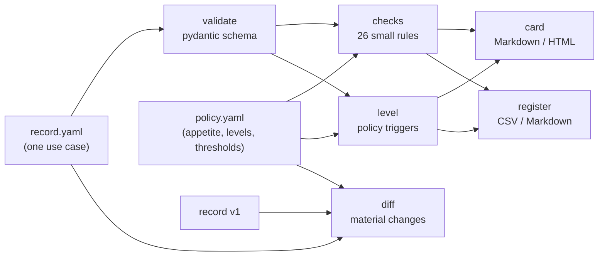

# ai-assurance-kit

Describe one AI use case as a structured record, validate it, run explainable checks, and get a one-page card and a portfolio register. The aim is proportionate AI assurance that a team can start in an afternoon.

> [!IMPORTANT]
> **Unofficial. Not government guidance.** This kit is *informed by* public UK guidance (the AI Playbook for the UK Government, the Algorithmic Transparency Recording Standard, ICO guidance on DPIAs, the AQuA Book and the Orange Book) and by the NIST AI Risk Management Framework. It does not implement, certify or satisfy any of them. Its checks are prompts for human judgement, not verdicts. See [docs/SOURCES.md](docs/SOURCES.md) for what was checked and how.

## The problem

Most organisations now have a list of AI use cases and a principle that assurance should be "proportionate". Few have a practical way to get from one to the other. Teams are asked for long assessment documents that nobody can compare, diff or re-check, so the light cases wait as long as the risky ones, and the risky ones change after approval without anyone noticing.

The questions a reviewer needs answered are usually short. Who owns it? What data does it touch? Can it send or write, or only read and draft? Who relies on the output, and for what? What evidence says it works? When will someone look again? This kit makes those answers structured, so a machine can do the tedious part (spotting gaps and changes) and people can do the part that needs judgement.

## What this does

- **A record schema** for one AI use case: purpose, accountable roles, system, data, connectors and permissions, what the system does with its outputs, who relies on them, risks, controls, evaluation evidence, governance decisions, transparency determination and review dates. Written in YAML, validated with pydantic, and exported as JSON Schema so anyone can validate without Python.
- **26 explainable checks.** Each has an ID, a severity, a rationale and citations, and each result is phrased as a prompt: "record who decided...", not "non-compliant". Examples: sends or writes without a human approval step; personal data with no DPIA screening recorded; public-facing, so "ATRS: likely in scope, record the determination"; builder and assurer are the same person; live with no named maintainer or no evaluation evidence; review date passed; risk above appetite with no owner. Full list: [docs/RULES.md](docs/RULES.md).
- **Proportionality levels** computed from named record features under a policy file, with every reason shown. The bundled policy (standard / use-specific review / senior or specialist approval) is an **example to adapt**, not a recommendation.
- **Change review.** `aiak diff` compares two versions of a record and flags material changes that should trigger re-review: new data, new connectors or permissions, new recipients or groups relying on the outputs, a move from drafts to autonomous sends, a removed safeguard (approval step, human review, stop mechanism, challenge route, user notice), a rise in scale, a new model, going live.
- **Outputs people will read.** A one-page card in Markdown or standalone, print-ready, accessible HTML, and a portfolio register in CSV or Markdown.
- **A crosswalk** from record fields and checks to the AI Playbook principles, ATRS sections and NIST AI RMF functions: [docs/CROSSWALK.md](docs/CROSSWALK.md).

## Quickstart

Needs Python 3.11 or later. Everything runs offline; no API keys.

```bash
git clone https://github.com/dsugurtuna/ai-assurance-kit.git
cd ai-assurance-kit
python -m venv .venv && source .venv/bin/activate
pip install -e .
```

Start a record of your own, then check it:

```bash
aiak init my-use-case.yaml
aiak check my-use-case.yaml
```

Try the fictional examples:

```bash
aiak check examples/ --today 2026-09-30
aiak check examples/service-chatbot.yaml --explain
aiak render examples/service-chatbot.yaml -o chatbot-card.html
aiak diff examples/history/grant-triage.v1.yaml examples/grant-triage.yaml
aiak register examples/ -o register.csv
```

`--today` fixes the "as at" date so output is reproducible; leave it out to check as at today. Real output of `aiak check examples/grant-triage.yaml --today 2026-09-30`:

```text
Unofficial. Not government guidance. Checks are prompts for human judgement, not verdicts.

examples/grant-triage.yaml
  Grant application triage  [status: in_test]
  Level: Senior or specialist approval  (policy: Example policy (adapt before use))
    - Senior or specialist approval: Outputs significantly influence decisions that affect the
      public or organisations. (significant_public_effect = true)
    - Senior or specialist approval: The system sends or writes without a person approving each
      action. (action_mode = autonomous)
    - Use-specific review: Personal data is processed. (personal_data = true)
    - Use-specific review: The system itself sends or writes, even if a person approves each
      action. (sends_or_writes = true)
    - Use-specific review: Outputs support decisions, so errors can shape outcomes. (decision_role =
      decision_support)
  Prompts for human judgement, not verdicts: 2 high, 2 warning, 0 info
    HIGH    AIAK-ACT-001  Sends or writes without a human approval step
            The system sends or writes without a person approving each action. Record who decided
            that per-action approval is not needed, the limits that apply (what, to whom, how often)
            and how errors are noticed and reversed.
    HIGH    AIAK-RISK-001  Risk above appetite with no owner
            Risk R4 scores 3 x 4 = 12, above the policy appetite of 9, and has no owner. Name the
            role that owns it.
    WARNING AIAK-ACT-002  No way to stop the system is recorded
            Record how the system can be paused or switched off quickly, who can do it, and when it
            was last tried.
    WARNING AIAK-RISK-002  Risk above appetite with no control in place
            Risk R4 (12) is above appetite and it has no linked controls. Put a control in place, or
            record who accepts the risk.
```

All three example organisations, people and figures are invented. Rendered cards for them are in [examples/cards/](examples/cards/).

### Other commands

| Command | What it does |
|---|---|
| `aiak validate FILE...` | Schema validation only. |
| `aiak check FILE... --format json` | Machine-readable results, including sources for each prompt. |
| `aiak check records/ --fail-on high` | Exit 1 if any prompt is at or above a severity. Use in CI. |
| `aiak diff OLD NEW --fail-on-material` | Exit 1 if the change needs re-review. |
| `aiak render FILE --redact-names` | Card with role titles only, no personal names. |
| `aiak schema -o schema.json` | Export the JSON Schema. |
| `aiak rules [--format md]` | List the checks. |
| `aiak policy [--features \| --validate FILE]` | Print the example policy, list the features it can use, or validate your own. |

Validate records without Python, with any JSON Schema (2020-12) validator. For example, with [check-jsonschema](https://github.com/python-jsonschema/check-jsonschema):

```bash
check-jsonschema --schemafile schema/ai-use-record.schema.json examples/*.yaml
```

## What is on the card

One page, in this order, as Markdown or as a standalone HTML file with no scripts and no external resources:

1. **Header**: title, the "unofficial" line, status, record version, the date it was checked as at, and the next review date (marked overdue if passed).
2. **Summary**: the record's two or three plain-English sentences.
3. **At a glance**: purpose; business owner, builder, maintainer, assurer and approver; system and hosting; data categories; personal data, DPIA status and retention; connectors with their permissions; what the system does with its outputs and who approves it; who relies on the outputs and how; public-facing and public-effect flags; the ATRS determination.
4. **Proportionality level**, what it asks for, and every policy trigger that fired, with the condition that matched.
5. **Prompts for human judgement**, most severe first, each with its rule ID.
6. **Risks**, highest score first, marked where above appetite, with owner and linked controls and their status.
7. **Evidence and decisions** as one dated timeline.
8. **Footer**: links to the sources behind the prompts that fired, and the file it was generated from.

The HTML card uses semantic landmarks, table headers with scope, text labels as well as colour for severity, a dark-mode palette on screen and A4 print styles. `--redact-names` shows role titles only, for sharing beyond the team.

## How it works



- `schema.py`: the record. Unknown fields are errors. Action mode, decision role and status are ordered, so a diff can tell "more autonomous" from "less".
- `checks/`: a registry of plain functions, each wrapped with metadata (ID, severity, rationale, citations). A rule returns zero or more prompts, each pointing at the fields it concerns.
- `levels.py` and `policy.py`: fourteen named features (for example `personal_data`, `action_mode`, `significant_public_effect`, `max_risk_score`) and a policy that maps feature conditions to levels. The highest level reached wins; every trigger that fired is reported.
- `diff.py`: a generic field-by-field diff plus a short list of material-change rules, each with a reason.
- `render.py`, `register.py` and `templates/`: Jinja2 templates, autoescaped for HTML.
- `sources.py`: the only sources rules may cite, including the checked text of the NIST AI RMF subcategories used.
- `docs.py`: generates [docs/RULES.md](docs/RULES.md) and the checks table in [docs/CROSSWALK.md](docs/CROSSWALK.md); tests fail if either drifts from the code.

## Design decisions

- **Prompts, not verdicts.** The kit sees only what the record says. Whether a DPIA is needed, whether a tool is in ATRS scope, or whether a risk is acceptable are decisions for accountable people. So every result says what to record or decide, severities say how soon, and `aiak check` exits 0 unless you ask it to gate with `--fail-on`.
- **No model in the loop.** The checks are deterministic Python, so the same record always gives the same result, offline. An assurance tool that needed its own assurance would not help. (A second model is a critic, not a verifier.)
- **Structure over prose.** YAML in git can be diffed, reviewed in a pull request, aggregated into a register and validated by any JSON Schema tool. A long document can do none of those.
- **Read freely, write carefully.** What the system does with its outputs is an ordered field (`read_only` < `drafts` < `writes_with_approval` < `autonomous`) and connector permissions are explicit, so the checks can spot sends without approval and permissions the system does not need.
- **Permission to build is not permission to deploy.** Approving a build, connecting data, granting access, sharing and going live are recorded as separate decisions, and `aiak diff` treats new connectors, permissions, recipients and users as material.
- **Policy separate from mechanism.** Risk appetite, levels and triggers live in one YAML file that each organisation owns. The bundled one is labelled as an example everywhere it appears.
- **Roles, with names optional.** Role titles are required; names are optional and can be redacted from cards. Published transparency records usually name roles, not people, but internal assurance sometimes needs names to notice that the builder is also the assurer.
- **Every rule cites its sources, from a checked list.** A reviewer can trace why a prompt exists. Citations mean "relevant to this prompt", never "required by".
- **Reproducible output.** `--today` fixes the date the record is checked as at, so cards and registers can be regenerated byte for byte and used as snapshot tests.

The reasoning behind each choice, and the hard questions it raises, are in [docs/WHY.md](docs/WHY.md).

## Limitations and what it is not

- **It checks the record, not the system.** A record can be wrong, stale or optimistic. The kit makes claims explicit and easy to challenge; it cannot verify them.
- **Not legal advice and not a compliance tool.** It does not decide DPIA, ATRS or automated decision-making questions. It notices when no decision is recorded.
- **Not an ATRS record.** The crosswalk shows where record fields relate to ATRS sections, but publishing still means completing the official template.
- **The example policy is illustrative.** Its appetite (9 on a 1 to 25 scale), levels and triggers were chosen to demonstrate the mechanism, not taken from any organisation.
- **Risk scores are ordinal.** Likelihood x impact on 1 to 5 scales is familiar and coarse. The kit shows the score, the owner and the controls so the number is not the whole story.
- **One record per use case.** Systems with several models or very different deployment contexts may need several records.
- **Some UK-specific prompts.** `AIAK-TRANS-001` (ATRS) matters mainly to UK public sector bodies; disable it in your policy if it does not apply, preferably after recording why.
- **Source checking had limits.** GOV.UK, ICO and NIST websites could not be reached from the environment this was built in, so some sources were checked through official copies on GitHub or only by search. [docs/SOURCES.md](docs/SOURCES.md) says which.

## Roadmap

- Export a draft ATRS-shaped skeleton (Tier 1 and Tier 2 headings) from a record, leaving gaps visible.
- Attach evidence files by hash, and import results from evaluation harnesses.
- A GitHub Action and pre-commit hook for repositories of records.
- Qualitative risk ratings as an alternative to likelihood x impact.
- Records for systems with several components.

Related projects in this portfolio: [agent-guardrails](https://github.com/dsugurtuna/agent-guardrails) (runtime controls for AI agents that write or send) and [evidence-synthesis-eval](https://github.com/dsugurtuna/evidence-synthesis-eval) (evaluation of AI-assisted evidence synthesis, including human checking effort).

## Development

```bash
pip install -e ".[dev]"
pytest
ruff check . && ruff format --check .
mypy
```

After changing a rule, regenerate the docs with `aiak rules --format md > docs/RULES.md` and paste `aiak rules --format crosswalk` over the generated block in `docs/CROSSWALK.md`. After changing a template, regenerate the example cards with `AIAK_UPDATE_SNAPSHOTS=1 pytest tests/test_render.py`. See [CONTRIBUTING.md](CONTRIBUTING.md).

## Licence

Apache License 2.0. See [LICENSE](LICENSE).

---

Personal project by [Ugur Tuna](https://github.com/dsugurtuna). Not affiliated with or endorsed by any employer.
